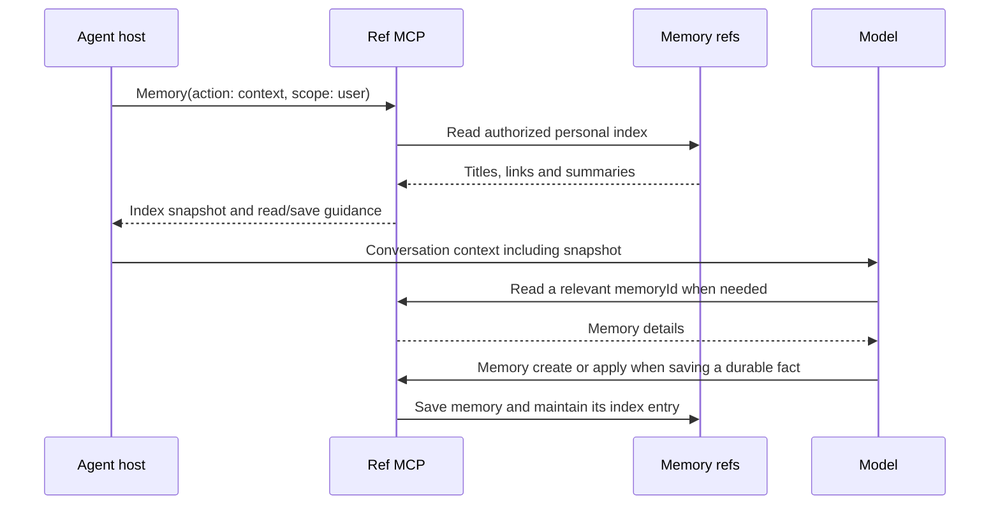

Ref memory separates durable storage from conversation context. Ref stores the memories. The agent host decides when to load an index into a conversation. The model decides which records to read and when to save or correct a fact.

For setup and examples, start with the [memory overview](/plans/memory/overview).

## A small index, with details on demand

Each memory is a ref containing a short title, an opening sentence stating the fact, and optional supporting detail. A separate index ref links to those records and includes their summaries.

The external-agent context response contains a bounded index, not every memory body. The current implementation returns up to 30 entries and marks partial results. The agent can read the full index when it is truncated, then read individual memories relevant to its task. This is an index-driven lookup, not a semantic search of every past conversation.

A personal index belongs to a user within a Ref space. Team memory has a separate index. The server derives the authorized scope from the authenticated session; the external-agent context request cannot name another user or request a team index.

## From a new chat to useful context



The host's recall hook calls the existing `Memory` tool with:

```json
{ "action": "context", "scope": "user" }
```

That request needs no conversation transcript, user prompt, or session identifier. It reads the index without creating memories or delivery records. The response includes the index and guidance for using it alongside native memory.

An excerpt of that guidance:

> Use Ref alongside native memory. Keep native memory working normally; when saving or correcting a durable fact there, also save or correct it through Ref Memory.

The guidance also tells the agent to read relevant records, update existing memories rather than create duplicates, respect the user's current direction, avoid secrets and temporary task state, and only report saves confirmed by tools. These are instructions to the agent, not an atomic replication mechanism between memory stores.

## Host support and lifecycle

| Host or connection | How memory reaches the conversation |
| --- | --- |
| Ref threads | Ref supplies its own memory guidance and available personal and team index context. If an index is absent, the agent is directed to list memories. External-agent plugins are not required for this built-in path. |
| Local Claude Code with memory enabled | A JavaScript module handles `prompt.context`, resolves the existing MCP connection, and appends a `refMemory` context block. Tested minimum: 2.1.321. |
| Local Codex with memory enabled | A declarative `mcp_tool` hook calls Memory on `SessionStart` events matching `startup`, `clear`, or `compact`. Resume is deliberately excluded. Tested minimum: 0.167.0; hook trust is required. |
| MCP connection without a memory hook | The model can use `Memory` and `Read` on request. The MCP connection alone does not install lifecycle hooks. |
| Claude Chat, Cowork, and cloud orchestration surfaces | Do not infer automatic recall from a plugin or connector appearing. Component support and hook permissions differ by host. |

Claude documents mods for its Code CLI, desktop Code tab, and VS Code extension. Ref's module uses that mod API; regular Chat and Cowork are not equivalent execution environments. [Claude mod support](https://code.claude.com/docs/en/plugins/mods/overview).

The Claude module uses the server name returned by `mcp.connect`, so it can reuse an existing connector even if its displayed name differs from the plugin's configured name. It appends Ref context without finding, parsing, or rewriting native memory instructions. Connection or recall failures produce diagnostics and preserve the existing context.

The memory hook itself does not invoke the Ref CLI. In a local installation, the CLI manages enable/disable registration and the existing MCP authentication helper. The OAuth marketplace package uses the host's authentication and needs no Ref CLI at runtime.

## How saves and corrections work

Automatic recall does not itself write a memory. After receiving the guidance, the model can use `Memory` to create a record or apply edits to an existing `memoryId`. The server maintains the corresponding index entry from the memory's title and opening sentence.

When a fact changes, the intended flow is: find the existing entry, read it, update that record, and confirm the result. Independent agents connected to the same account and space can subsequently retrieve that updated Ref record.

Native memory remains separate. A model may save to both stores, but the writes are independent: one can succeed while the other fails. Ref does not monitor native memory files, import an entire native store, or reconcile conflicting copies automatically. The guidance requires the agent to report each store's outcome accurately.

## Fresh data and conversation snapshots

There are three different kinds of reuse to distinguish:

1. **Saved Ref records.** A subsequent authorized MCP read can retrieve updates saved by another agent. The memory context handler has no separate response cache or per-session delivery ledger.
2. **The host's conversation snapshot.** Once loaded, the index can remain in context across turns or a resumed chat. A server-side update does not push a replacement into every open conversation. Refresh timing depends on the host's context lifecycle; do not assume a read on every model call, or exactly one read on every supported host.
3. **Provider prompt caching.** A provider may reuse processing of a repeated prompt prefix. That does not refresh the index, remove its tokens from the context window, or make duplicated context disappear. Actual caching and billing depend on the provider.

For current data during an existing chat, ask the agent to refresh Ref memory. It can call:

```json
{ "action": "list", "scope": "user" }
```

Then it can `Read` the relevant `memoryId`, or the returned `indexId` for the full index if the result is truncated. These reads provide current context without requiring a new chat.

The index design keeps full bodies out of automatic recall. The summaries and guidance still occupy context tokens, as do any full memories subsequently read. Ref does not rely on the model to deduplicate repeated injections.

## Verify your connection

Use a harmless test fact and check each part separately:

1. Ask one agent to save a distinct preference in Ref. Confirm a successful Memory tool result.
2. Start a new chat in another supported agent, connected to the same account and space, with automatic memory enabled.
3. Ask it to check that preference. Inspect the hook diagnostics or tool activity to distinguish an automatically supplied index from an explicit lookup.
4. Correct the memory in the first agent. In the second, explicitly request a fresh list and read; verify that it retrieves the correction.

A successful installation, a visible MCP server, or a correct answer by itself does not prove automatic recall. The fact might already be in the conversation or in native memory. An empty skills list also says nothing about the memory hook: this plugin adds MCP tools and a module, not a slash-command skill.
