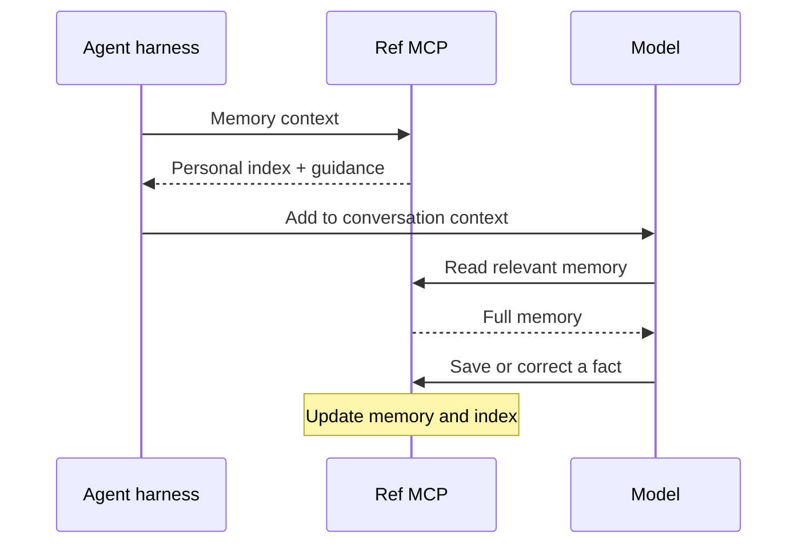

Ref provides a shared memory store through MCP. Agents keep deciding what to remember and when it matters; Ref makes those records available across providers and harnesses.

## Memories are refs

Each memory is a readable ref with a title, a summary, and optional detail. A separate index links to the memories and summarizes them. The server maintains the index when an agent creates or updates a memory.

Personal memory belongs to a user within a Ref space. Other agents connected to that same account and space can access it. Team memory has a separate index; the server enforces access from the authenticated session.

Explore the [sample index](https://plan.ref.tools/mini-app/?demo=memory) and a [full memory](https://plan.ref.tools/mini-app/?demo=memory#review-style) in the interactive demo. The content is fictional.

## How agents receive it

Ref's host integration loads a personal index through the MCP `Memory` tool. The response contains titles, links, summaries, and read/save guidance. Agents use `Read` to open relevant memories and `Memory` to create or update them.

The context request needs no transcript, prompt, or session identifier. It returns up to 30 entries and marks truncated results so the agent can read the full index.

| Host | Ref integration |
| --- | --- |
| Ref threads | Built-in guidance and personal/team index context. |
| Claude Code | A `prompt.context` module appends Ref context through the existing MCP connection. |
| Codex | A `SessionStart` hook loads Ref context on startup, clear, or compaction; not resume. |
| MCP alone | Memory tools are available, but automatic context injection requires host integration. |

Hook support depends on the host. A connector in Claude Chat or Cowork does not imply support for the Claude Code module.

## How updates travel

A saved correction updates the Ref record and its index entry. Another agent's next read can retrieve it. Ref does not push replacements into conversations that already hold an earlier snapshot; an agent can refresh through `Memory` and `Read`.

The MCP context handler has no separate response cache or per-session delivery ledger. Conversation snapshots and provider prompt caching belong to the harness and provider; neither refreshes the saved index automatically.

Ref currently works alongside native memory. Its guidance asks agents to save durable facts to Ref too. These are independent writes, not file synchronization or bulk import of a native memory store.
