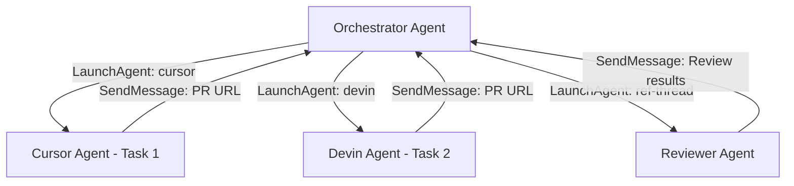

import GetHelp from '/snippets/get-help.mdx';

Multi-agent orchestration lets a Ref agent (the orchestrator) spawn sub-agents on Cursor, Devin, Warp OZ, local ACP (Claude Code, Codex, OpenCode), or internal ref-threads, send them messages, and receive updates back — all via MCP tools. This is the most automated way to use Ref Plans.

## How it works

An orchestrator agent reads your plan, then launches child agents to implement and review tasks in parallel. The agents communicate through a parent/child messaging system — no polling required for cloud and ref-thread children. Local ACP children can also wake a ref-thread parent; other parents watch them with `ManageAgent`.

## The tools

`LaunchAgent` and `SendMessage` power orchestration for every harness. When local ACP (`local_acp`) is enabled, `ManageAgent` is also registered so a parent can watch and drive the local ACP runs it launched.

### LaunchAgent

Launches a sub-agent to work in parallel. Available harness types:

| Harness | Use for | What it does |
| --- | --- | --- |
| `cursor` | Implementation tasks | Launches a Cursor background agent that writes code and creates PRs |
| `devin` | Implementation tasks | Launches a Devin session that writes code and creates PRs |
| `warp-oz` | Implementation tasks | Launches a Warp OZ agent that writes code and creates PRs |
| `local` | Implementation on your machine | Launches Claude Code, Codex, or OpenCode over ACP on a paired device (`local_acp`) |
| `ref-thread` | Review and lightweight tasks | Launches an internal Ref agent that can read PRs, review diffs, approve, and merge |

Key parameters:
- **`planIds`** — Plan IDs the agent should be associated with
- **`prompt`** — The complete task request with all context, requirements, and instructions
- **`harness`** — Where to run the agent: `cursor`, `devin`, `warp-oz`, `local`, or `ref-thread`
- **`taskShortDescription`** — Brief label for the agent (~10 words)
- **`repo`** / **`branch`** / **`model`** — Optional overrides (Cursor only; `local` also needs `deviceId` and optional `provider`)

### SendMessage

Sends a message between parent and child agents. This is how agents communicate — including prompts to a local ACP child:

- **Child agents** MUST message their parent when work is complete (including the PR URL) or when stuck
- **Parent agents** use this to send follow-up instructions or course corrections
- **Local ACP prompts** stay here — `ManageAgent` does not send prompts

Parameters:
- **`agentId`** — The agent to send the message to
- **`message`** — The message content

### ManageAgent

Watch and drive a local ACP agent you launched: read its status and compact log, answer a permission (not `allow_always`), change model or mode, cancel the turn, or stop the run. Prompting stays in `SendMessage`. Registered only when local ACP (`local_acp`) is on — for Claude Code, Codex, or OpenCode runs started with `LaunchAgent` harness `local`.

| Action | Params | What it does |
| --- | --- | --- |
| `read` | `afterSeq?`, `limit?` (default 40, max 200), `waitSeconds?` (0–50) | Status, pending permission, capped log, and `nextSeq`. Default `afterSeq` is the last turn start. `waitSeconds` long-polls until status or pending permission changes |
| `answer_permission` | `requestId`, `optionId` | Pick an offered option (`allow_always` returns `needs_human`) |
| `set_config` | `configId`, `value` | Change model or mode |
| `cancel` | — | End the turn; the session stays up |
| `stop` | `reason?` | End the run |

Every action takes `agentId`. Non-ACP runs return `not_acp_run`. Other errors include `not_found`, `not_allowed`, `needs_human`, `stale_request`, `invalid_option`, `invalid_value`, and `machine_offline`.

**Permissions.** A parent may answer once (`allow_once`, `reject_once`, `reject_always`). `allow_always` returns `needs_human` — it writes a lasting rule on the user's machine, so only the human may pick it. Whoever answers first wins.

**Who may drive.** The direct parent, or the user's own (user-scoped) session. A sibling or unrelated agent gets `not_allowed`.

**Parents without wakeups.** A Claude Code session (or any parent that is not a ref-thread) does not get automatic wake messages — use `read` with `waitSeconds` instead of a tight poll loop.

## Typical workflow

<Steps>
  <Step title="Plan">
    Research and iterate on your plan in the web client or via MCP. Break work into tasks that can be implemented independently.
  </Step>
  <Step title="Orchestrate">
    An orchestrator agent reads the plan and launches implementation agents (Cursor, Devin, or Warp OZ) in parallel via `LaunchAgent`. Each agent gets a self-contained prompt with all the context it needs.
  </Step>
  <Step title="Review">
    As implementation agents finish and report back with PR URLs, the orchestrator launches `ref-thread` agents to review each PR. Reviewers have access to GitHub tools (`ReadPR`, `ReviewPR`, `MergePR`) to inspect diffs and approve.
  </Step>
  <Step title="Merge and update">
    Once reviewers approve, they merge the PRs (if permitted). The orchestrator updates the plan to mark tasks complete. Repeat until the plan is done.
  </Step>
</Steps>

## Example session

Here's what a typical orchestration session looks like:

1. The orchestrator reads the plan and identifies three independent tasks
2. It launches two Cursor agents for Task 1 and Task 2 in parallel, and a Devin agent for Task 3
3. Task 1's agent finishes first and messages back: *"Task complete. PR: https://github.com/org/repo/pull/42"*
4. The orchestrator launches a ref-thread reviewer to review PR #42
5. Task 2's agent finishes and messages back with its PR URL
6. The reviewer approves and merges PR #42, then messages the orchestrator with results
7. The orchestrator updates the plan, marking Task 1 complete
8. The process continues until all tasks are implemented, reviewed, and merged

## Harness selection guide

**Use `cursor`, `devin`, or `warp-oz` for implementation** — these agents write code, create branches, and open PRs. Choose based on which service you have configured and prefer.

**Use `local` for implementation on your machine** — when `local_acp` is on, launch Claude Code, Codex, or OpenCode on a paired device. Drive the run with `ManageAgent`; keep prompts in `SendMessage`.

**Use `ref-thread` for reviews** — ref-thread agents have access to GitHub PR tools (`ReadPR`, `ReviewPR`, `MergePR`, `SearchPRs`) that implementation agents do not. Always use ref-thread for PR review tasks.

## Requirements

To use multi-agent orchestration, you need:

1. **Ref Plans MCP server installed** in your orchestrating agent — see the [install guide](/plans/install/index)
2. **API keys configured** for Cursor, Devin, and/or Warp OZ in [Agent Settings](https://plan.ref.tools/settings) — required for `cursor`, `devin`, and `warp-oz` harnesses
3. **GitHub connected** at [ref.tools/resources](https://ref.tools/resources) — required for ref-thread reviewers to access PR tools
4. **Local ACP (`local_acp`) enabled** — required for `LaunchAgent` harness `local` and for `ManageAgent`

## Parent/child messaging rules

- Child agents **must** message their parent when done (include the PR URL if one was created) or when stuck
- Parents can send follow-up instructions or corrections to any child via `SendMessage`
- Agents can only message their direct parent or their own children — no cross-communication
- The workflow is message-driven: after launching agents, wait for messages rather than polling

### Local ACP parent wakeups

When `local_acp` is on, a **ref-thread** parent is woken once per transition (never on event replay) when its local ACP child:

| Event | Wake message |
| --- | --- |
| Needs a permission | Needs permission: ‹title› (with options the parent may answer) |
| Errors or exits unasked | Errored: ‹code› ‹message› |
| Stopped in the browser (not by the parent) | Stopped by user |
| Machine goes offline mid-run | Machine offline, last seen ‹t› |
| Machine comes back | back online |
| Turn ends | Turn ended (‹stopReason›): ‹preview› — skipped when the parent asked for the cancel |

A stop or cancel the parent itself requested is silent. Parents that do not receive these wakeups (for example a Claude Code session driving a local child) should use `ManageAgent` `read` with `waitSeconds`.

### Waiting on CI

CI, deploys, and humans do not send messages — "wait for a message" only covers child agents. `ref-thread` agents with wake scheduling enabled arm a wake with the `Schedule` tool (`action: create`, `delaySeconds`), end the turn, and are woken by their own message to check again — so a reviewer that finds checks still running can merge on green without a human nudging it; without the `Schedule` tool the agent reports the pending state and stops.

- `Schedule` is a ref-thread tool: Cursor, Devin, and Warp OZ children do not have it.

<GetHelp/>
